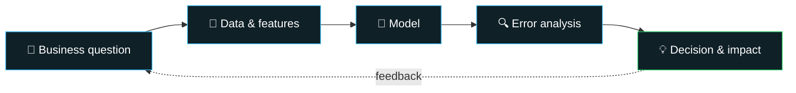

<div align="center">


<a href="https://github.com/JmineSA">
  
</a>

<br/>

[](https://telecom-consumption-intelligence-7u9fclgabrv8tttvf2jpsx.streamlit.app/)
[](https://www.linkedin.com/in/lesiba-kganyago-a39b302b0/)
[](mailto:lesibajmine@gmail.com)

**👇 Tap anything below to jump around 👇**

[**🎯 Impact**](#-business-impact) · [**💼 Experience**](#-experience) · [**🚀 Featured Project**](#-featured-project) · [**🛠️ Skills**](#️-technical-skills) · [**📊 GitHub Stats**](#-github-stats) · [**🤝 Connect**](#-connect-with-me)

</div>

---

## 👋 About Me

I build data analytics and machine learning solutions that connect **customer behaviour, revenue patterns and operational challenges to business decisions**.

My focus is on practical systems that go beyond model performance: identifying opportunities, quantifying business risk and supporting better decision-making.

```python
class LesibaKganyago:
    role     = "Data Scientist"
    based_in = "South Africa 🇿🇦"
    focus    = ["Revenue optimisation & forecasting",
                "Customer analytics, segmentation & retention",
                "Operational efficiency & demand planning",
                "Machine learning & decision-support systems"]
    mindset  = "A model is only useful if it changes a decision."
    open_to  = ["Data Science", "Data Analytics", "Applied ML"]
```

---

## 🎯 Business Impact

<div align="center">

| 🎵 Music Studio | 🥩 Retail | 📶 Telecom |
|:---:|:---:|:---:|
| **+8%** pricing strategy accuracy | **+15%** conversions via bundling | **R² 0.77** on held-out test set |
| **−15%** scheduling gaps | A/B testing & sales analysis | Revenue & network allocation opportunities (simulated data) |
| **84%** churn-risk precision | | |

</div>

<details>
<summary><b>📖 Click to see the full problem → approach → outcome breakdown</b></summary>

<br/>

| Business Problem | Approach | Outcome |
|---|---|---|
| 🎵 Music studio revenue and utilisation | Revenue forecasting, booking demand forecasting and retention modelling | Improved pricing strategy accuracy by **8%**, reduced scheduling gaps by **15%**, and achieved **84% precision** in identifying churn risk |
| 🥩 Retail conversion optimisation | A/B testing and sales analysis | Increased conversions by **15%** through product bundling |
| 📶 Telecom consumption forecasting | Predictive modelling, error analysis and revenue opportunity assessment | Achieved a test-set **R² of 0.77** and identified estimated revenue and network allocation opportunities using simulated data |

</details>

---

## 🧭 How I Work



---

## 💼 Experience

> 🖱️ **Expand each role** to see what I built and the stack behind it.

<details>
<summary><b>🎵 Studio Intelligence AI</b> — Data Science Consultant · <i>2024–2025</i></summary>

<br/>

Developed an analytics and machine learning solution to support revenue management, studio utilisation and customer retention.

- 💰 **Revenue forecasting:** Improved pricing strategy accuracy by **8%**, supporting more informed pricing decisions across peak and off-peak periods.
- 📅 **Booking demand forecasting:** Reduced scheduling gaps by **15%**, helping identify opportunities to improve utilisation and reduce idle capacity.
- 🎤 **Artist retention modelling:** Achieved **84% precision** in identifying high-risk clients, supporting targeted retention strategies.
- 🛡️ **Revenue protection:** Estimated potential annual recurring revenue protection of **R360K** through improved churn-risk identification.


</details>

<details>
<summary><b>🥩 Local Butcher Shop</b> — Data Analytics Consultant · <i>2024</i></summary>

<br/>

- 🧪 Designed and analysed an **A/B testing framework** that increased conversions by **15%** through product bundling.
- 🔎 Analysed sales and customer data using Python and SQL to identify purchasing patterns.
- 📦 Translated findings into recommendations for product bundling and inventory management.


</details>

---

## 🚀 Featured Project

<div align="center">

### 📶 Telecom Consumption Intelligence
**Simulated Telecom Analytics Engagement · Predictive Analytics & Business Intelligence**

An end-to-end analytics application exploring mobile data consumption forecasting, customer usage behaviour, revenue opportunities and network demand.

<a href="https://telecom-consumption-intelligence-7u9fclgabrv8tttvf2jpsx.streamlit.app/">
  
</a>
<a href="https://github.com/JmineSA/telecom-consumption-intelligence">
  
</a>

<br/><br/>

| 🎯 R² | 📉 MAE | 📏 RMSE | 🔗 30-day avg correlation |
|:---:|:---:|:---:|:---:|
| **0.77** | **2.021 GB** | **3.379 GB** | **≈ 0.866** |

</div>

<details open>
<summary><b>🔑 Key findings</b></summary>

<br/>

- **Forecasting performance:** Test-set **R² of 0.77**, MAE of **2.021 GB** and RMSE of **3.379 GB**.
- **Consumption drivers:** The 30-day rolling average was strongly associated with predicted usage, with a correlation of approximately **0.866**.
- **Network planning:** Forecast errors increased under congested network conditions, highlighting the importance of evaluating model performance across operating conditions.
- **Decision support:** An interactive Streamlit dashboard to explore consumption patterns, forecast performance, customer segments and potential business implications.

</details>

<details>
<summary><b>⚖️ Prediction errors, translated into money (click to expand)</b></summary>

<br/>

| Error type | Share of test set | Observations | Estimated business effect |
|---|:---:|:---:|---|
| ⬇️ **Underpredicted** | 57.9% | ~54,539 | **R7.34 million** top-up revenue opportunity |
| ⬆️ **Overpredicted** | 42.1% | ~39,664 | **R7.12 million** potential network over-allocation costs |

</details>

<details>
<summary><b>🧠 From predictions to decisions</b></summary>

<br/>

The project shows how forecast errors become operational questions:

- ❓ Where might actual consumption exceed predicted demand?
- ❓ Where could demand be overestimated, leading to inefficient capacity allocation?
- ❓ Which consumption patterns and network conditions deserve closer investigation?
- ❓ How should forecasts be evaluated before they inform operational decisions?

</details>

<details>
<summary><b>🧰 Tech stack</b></summary>

<br/>


</details>

> **⚠️ Data and financial assumptions:** This is a portfolio project built with simulated telecom data, not an engagement using a real telecom operator's production data. Revenue and network cost figures are model-based estimates, not verified revenue, realised savings or audited financial results. The evaluation metrics describe performance on the project's held-out test data.

---

## 📂 Featured Projects

| Project | Focus |
|---|---|
| 🎵 **Studio Intelligence AI** | Revenue forecasting, booking demand and customer retention |
| 📶 [**Telecom Consumption Intelligence**](https://github.com/JmineSA/telecom-consumption-intelligence) | Usage forecasting, prediction error analysis and network planning |
| 🥩 **Butcher Shop A/B Testing** | Conversion optimisation, experimentation and sales analytics |

---

## 🛠️ Technical Skills

<details open>
<summary><b>🤖 Machine Learning & Predictive Analytics</b></summary>

<br/>

`Regression` · `Classification` · `Time Series Forecasting` · `Gradient Boosting` · `XGBoost` · `Random Forest` · `LightGBM` · `Scikit-learn`

</details>

<details>
<summary><b>📊 Data Analysis & Business Intelligence</b></summary>

<br/>

`Pandas` · `NumPy` · `SQL` · `Customer Segmentation` · `Revenue Analysis` · `Profitability Analysis` · `Exploratory Data Analysis`

</details>

<details>
<summary><b>⚙️ Data Engineering</b></summary>

<br/>

`Python` · `SQL` · `PySpark` · `Databricks` · `Feature Engineering` · `ETL Pipelines`

</details>

<details>
<summary><b>🧪 Experimentation & Statistics</b></summary>

<br/>

`A/B Testing` · `Hypothesis Testing` · `T-tests` · `Chi-Square Tests` · `Statistical Analysis`

</details>

<details>
<summary><b>🖥️ Visualisation & Application Development</b></summary>

<br/>

`Power BI` · `Streamlit` · `Matplotlib` · `Seaborn` · `Plotly` · `Gradio` · `REST APIs`

</details>

<details>
<summary><b>🔁 MLOps</b></summary>

<br/>

`MLflow` · `Experiment Tracking` · `Model Versioning` · `Machine Learning Pipelines` · `Model Evaluation`

</details>

---

## 📊 GitHub Stats

<div align="center">


<br/>


</div>

---

## 🤝 Connect With Me

<div align="center">

I'm interested in opportunities across **data science, data analytics and applied machine learning**, where I can contribute to practical business problems and keep building end-to-end analytical systems.

<a href="https://www.linkedin.com/in/lesiba-kganyago-a39b302b0/"></a>
<a href="https://github.com/JmineSA"></a>
<a href="mailto:lesibajmine@gmail.com"></a>

<br/><br/>

> 💡 *Turning data into decisions by combining analytical thinking, predictive modelling and business understanding.*

⭐ Explore my repositories to see how I approach data problems, evaluate models and translate findings into actionable insights.


</div>
