 

 

[**Impact**](#business-impact) &nbsp;·&nbsp; [**Approach**](#how-i-work) &nbsp;·&nbsp; [**Experience**](#experience) &nbsp;·&nbsp; [**Featured Project**](#featured-project) &nbsp;·&nbsp; [**Skills**](#technical-skills) &nbsp;·&nbsp; [**Activity**](#github-activity) &nbsp;·&nbsp; [**Contact**](#contact)

  

## About

I build data analytics and machine learning solutions that connect **customer behaviour, revenue patterns and operational challenges to business decisions**.

My focus is on practical systems that go beyond model performance: identifying opportunities, quantifying business risk and supporting better decision-making.

| Focus area | What it means in practice |
|---|---|
| **Revenue optimisation and forecasting** | Pricing, demand and revenue models that inform commercial decisions |
| **Customer analytics and retention** | Segmentation and churn-risk identification that targets retention effort |
| **Operational efficiency and demand planning** | Forecasting that reduces idle capacity and over-allocation |
| **Decision-support systems** | Interactive applications that turn model output into actions |

## Business Impact

  

 

<b>View the full problem → approach → outcome breakdown</b>

 

| Business Problem | Approach | Outcome |
|---|---|---|
| Music studio revenue and utilisation | Revenue forecasting, booking demand forecasting and retention modelling | Improved pricing strategy accuracy by **8%**, reduced scheduling gaps by **15%**, and achieved **84% precision** in identifying churn risk |
| Retail conversion optimisation | A/B testing and sales analysis | Increased conversions by **15%** through product bundling |
| Telecom consumption forecasting | Predictive modelling, error analysis and revenue opportunity assessment | Achieved a test-set **R² of 0.77** and identified estimated revenue and network allocation opportunities using simulated data |

## How I Work

  

## Experience

  

 

> Expand a role to see what I built, the measurable outcomes and the stack behind it.

<b>Studio Intelligence AI</b> &nbsp;·&nbsp; Data Science Consultant &nbsp;·&nbsp; <i>2024–2025</i>

 

Developed an analytics and machine learning solution to support revenue management, studio utilisation and customer retention.

- **Revenue forecasting:** Improved pricing strategy accuracy by **8%**, supporting more informed pricing decisions across peak and off-peak periods.
- **Booking demand forecasting:** Reduced scheduling gaps by **15%**, helping identify opportunities to improve utilisation and reduce idle capacity.
- **Artist retention modelling:** Achieved **84% precision** in identifying high-risk clients, supporting targeted retention strategies.
- **Revenue protection:** Estimated potential annual recurring revenue protection of **R360K** through improved churn-risk identification.

<b>Local Butcher Shop</b> &nbsp;·&nbsp; Data Analytics Consultant &nbsp;·&nbsp; <i>2024</i>

 

- Designed and analysed an **A/B testing framework** that increased conversions by **15%** through product bundling.
- Analysed sales and customer data using Python and SQL to identify purchasing patterns.
- Translated findings into recommendations for product bundling and inventory management.

## Featured Project

### Telecom Consumption Intelligence
**Simulated Telecom Analytics Engagement &nbsp;·&nbsp; Predictive Analytics & Business Intelligence**

An end-to-end analytics application exploring mobile data consumption forecasting, customer usage behaviour, revenue opportunities and network demand.

  

| R² (test) | MAE | RMSE | 30-day avg. correlation |
|:---:|:---:|:---:|:---:|
| **0.77** | **2.021 GB** | **3.379 GB** | **≈ 0.866** |

 

<b>Key findings</b>

 

- **Forecasting performance:** Test-set **R² of 0.77**, with an MAE of **2.021 GB** and an RMSE of **3.379 GB**.
- **Consumption drivers:** The 30-day rolling average was strongly associated with predicted usage, with a correlation of approximately **0.866**.
- **Network planning:** Forecast errors increased under congested network conditions, highlighting the importance of evaluating model performance across operating conditions.
- **Decision support:** An interactive Streamlit dashboard to explore consumption patterns, forecast performance, customer segments and potential business implications.

<b>Prediction errors, translated into business terms</b>

 

| Error type | Share of test set | Observations | Estimated business effect |
|---|:---:|:---:|---|
| **Underpredicted** | 57.9% | ~54,539 | **R7.34 million** top-up revenue opportunity |
| **Overpredicted** | 42.1% | ~39,664 | **R7.12 million** potential network over-allocation costs |

<b>From predictions to decisions</b>

 

The project demonstrates how forecast errors can be translated into operational questions:

- Where might actual consumption exceed predicted demand?
- Where could demand be overestimated, leading to inefficient capacity allocation?
- Which consumption patterns and network conditions deserve closer investigation?
- How should forecasts be evaluated before they inform operational decisions?

<b>Tech stack</b>

 

> **Data and financial assumptions:** This is a portfolio project built with simulated telecom data, not an engagement using a real telecom operator's production data. Revenue and network cost figures are model-based estimates, not verified revenue, realised savings or audited financial results. The evaluation metrics describe performance on the project's held-out test data.

## Project Portfolio

 

| Project | Focus |
|---|---|
| **Studio Intelligence AI** | Revenue forecasting, booking demand and customer retention |
| [**Telecom Consumption Intelligence**](https://github.com/JmineSA/telecom-consumption-intelligence) | Usage forecasting, prediction error analysis and network planning |
| **Butcher Shop A/B Testing** | Conversion optimisation, experimentation and sales analytics |

## Technical Skills

  

 

  

## GitHub Activity

  
    
  
    
  

## Contact

I'm interested in opportunities across **data science, data analytics and applied machine learning**, where I can contribute to practical business problems and keep building end-to-end analytical systems.

 

